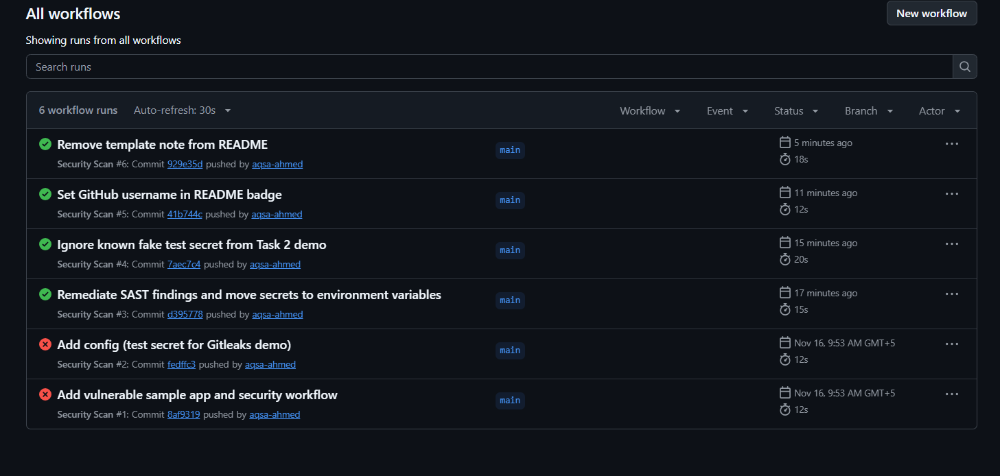

# SkillUp Academy: Security Handover


**Prepared by:** Aqsa Zubair  
**For:** SkillUp Academy engineering team  
**Scope:** Linux host hardening (Task 1), CI security gates (Task 2), remediation and handover (Task 3)

## 1. Executive summary

SkillUp Academy handles student data, so the platform was moved to a secure-by-design approach:

- The Ubuntu application server was hardened (section 3).
- Every push now runs automated secret scanning (Gitleaks) and static analysis (Bandit), and a failing scan fails the build (section 4).
- All issues found by those scanners were fixed, and the pipeline now passes (section 5).

**Current status:** all scans green

## 2. Security architecture

```
Developer -> git push -> GitHub Actions --+-- Gitleaks (secrets) --+
                                          +-- Bandit (SAST)  -----+--> pass / fail
Secrets: environment variables only (never in the repo)
Host:    hardened Ubuntu server (SSH, firewall, updates, least privilege)
```

## 3. Host security controls (Ubuntu server)


| Control | What was done | How to verify |
|---|---|---|
| SSH hardening | Root login disabled, key-based auth, password auth disabled | `sshd -T \| grep -E "permitrootlogin\|passwordauthentication"` |
| Firewall | UFW default-deny incoming; only required ports open | `sudo ufw status verbose` |
| Patching | Unattended security updates enabled | `systemctl status unattended-upgrades` |
| Users and privileges | Non-root admin user, least privilege sudo | `getent group sudo` |
| Brute-force protection | Fail2ban on SSH | `sudo fail2ban-client status sshd` |
| Audit/logging | Auth logs reviewed, logging enabled | `sudo tail /var/log/auth.log` |

## 4. Pipeline security controls

Workflow: `.github/workflows/security.yml`, runs on every `push` and `pull_request`.

| Gate | Tool | Behaviour |
|---|---|---|
| Secret scanning | Gitleaks (full history, `fetch-depth: 0`) | Fails the build if any secret is detected |
| SAST | Bandit: `bandit -r app -ll` | Fails the build on medium or higher severity findings |

## 5. Vulnerability remediation



| # | Finding | Tool / ID | Before | After |
|---|---|---|---|---|
| 1 | SQL injection | Bandit B608 | Query built with string formatting | Parameterized query: `execute("... WHERE name = ?", (name,))` |
| 2 | Command injection | Bandit B602 | `subprocess` with `shell=True` and user input | Input validated with an allow-list regex; `subprocess.run([...])` as an argument list, no shell, with a timeout |
| 3 | Flask debug mode on | Bandit B201 | `app.run(debug=True)` | Debug is read from `FLASK_DEBUG` and is off by default |
| 4 | Hardcoded secrets | Gitleaks | `SECRET_KEY` and `DB_PASSWORD` in `config.py` | Read from environment variables via `os.environ` |

### Secrets handling

- Secrets are loaded with `os.environ["NAME"]`, so the app fails fast if one is missing.
- `.env` is listed in `.gitignore`. `.env.example` documents the variables with placeholder values.
- In GitHub, store values under **Settings > Secrets and variables > Actions**. On the server, set them in the service's environment, not in files in the repo.
- The old test secrets remain in git history. They were fake. A **real** leaked secret must be rotated, because deleting it from the latest commit does not remove it from history.

## 6. Running locally

```bash
python -m venv venv && source venv/bin/activate
pip install -r requirements.txt
cp .env.example .env        # then edit the values
export $(grep -v '^#' .env | xargs)
python app/app.py
```

Run the scans before pushing:

```bash
pip install bandit && bandit -r app -ll
gitleaks detect --source . -v
```

## 7. Maintaining these protections

- **Never bypass the pipeline.** Fix the finding rather than silencing it. If a finding is a genuine false positive, document it in the pull request.
- **Turn on branch protection** for `main` and require the Gitleaks and Bandit checks to pass before merging.
- **Rotate secrets** on a schedule and immediately after any suspected leak.
- **Keep dependencies updated** (enable Dependabot) and keep Bandit and Gitleaks current.
- **Patch the server** regularly and review `auth.log` and firewall rules monthly.
- **Re-audit quarterly:** re-run the host checks in section 3 and review the pipeline.

## 8. Limitations and recommended next steps

- Bandit only analyses Python. Add dependency scanning (`pip-audit` or Dependabot) and container or IaC scanning as the stack grows.
- SAST cannot find every flaw. Add tests and periodic manual review or penetration testing.
- Add secret scanning push protection in the repository settings.

## 9. Repository structure

```
.github/workflows/security.yml   CI security gates
app/app.py                       Application (remediated)
app/config.py                    Configuration from environment variables
.env.example                     Variable template (no real values)
.gitignore
requirements.txt
docs/                            Evidence screenshots
```
